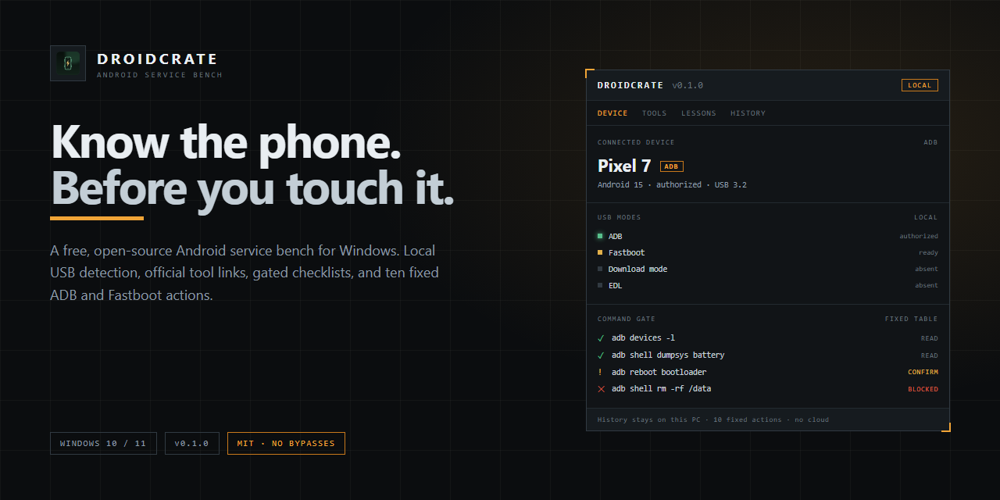
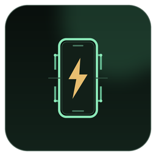
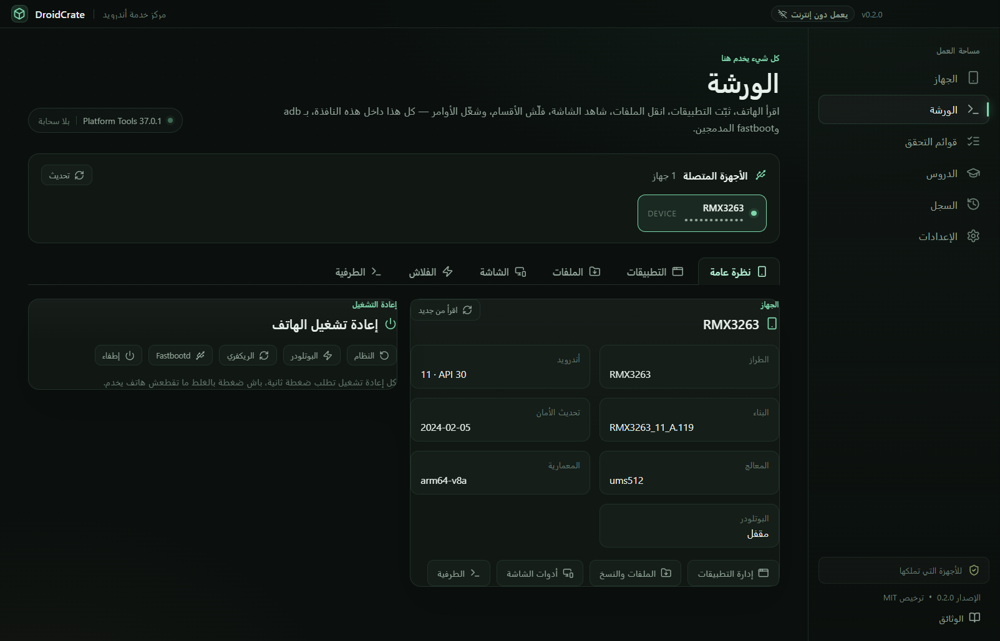
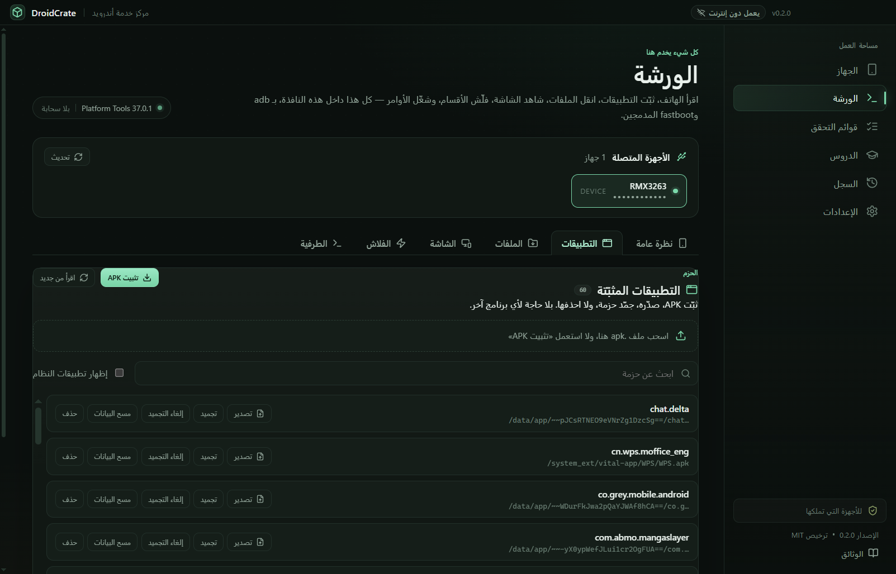
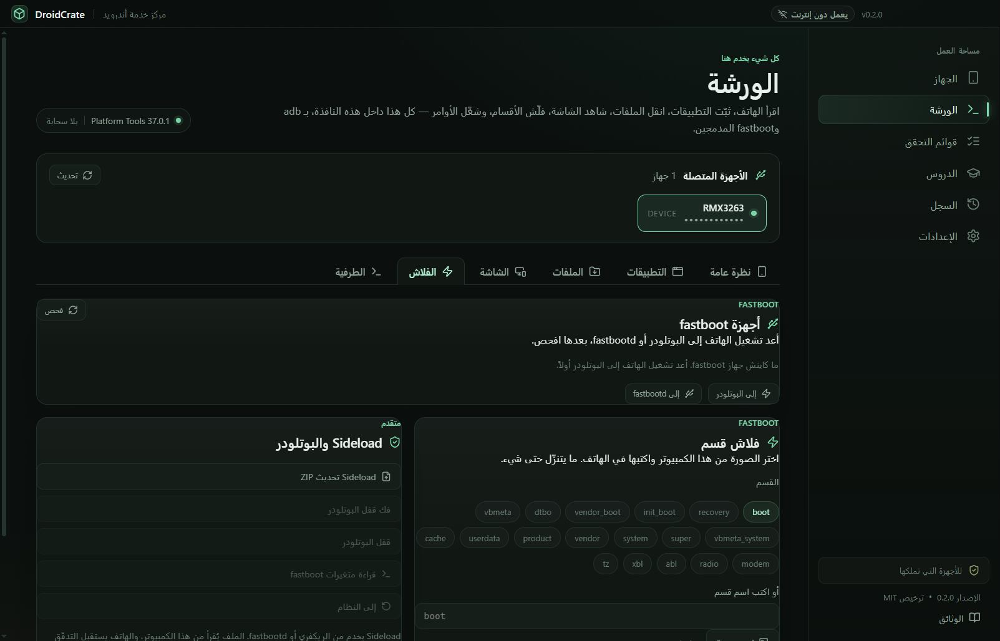

<p align="center">
  <a href="docs/banner.png"></a>
</p>

<p align="center">
  
</p>

<h1 align="center">DroidCrate · درويد كريت</h1>

<p align="center">
  <strong>كل ما تحتاجه للهاتف، في نافذة واحدة.</strong><br />
  ورشة أندرويد مجانية ومفتوحة المصدر لويندوز: ثبّت التطبيقات، انقل الملفات، شاهد الشاشة،
  فلّش الأقسام، وشغّل أوامر adb وfastboot — بلا ما تفتح برنامجاً أو موقعاً آخر.
</p>

<p align="center">
  <a href="https://github.com/bouadjadjatamer2-hub/DroidCrate/releases/download/v0.2.0/DroidCrate-0.2.0-Setup.exe"></a>
</p>

<p align="center">
  <a href="https://github.com/bouadjadjatamer2-hub/DroidCrate"></a>
  <a href="https://github.com/bouadjadjatamer2-hub/DroidCrate/releases/tag/v0.2.0"></a>
  <a href="LICENSE"></a>
  <a href="https://github.com/bouadjadjatamer2-hub/DroidCrate/releases"></a>
  
</p>

<p align="center">
  <a href="#التثبيت">التثبيت</a> ·
  <a href="#الورشة">الورشة</a> ·
  <a href="#لقطات-الشاشة">لقطات الشاشة</a> ·
  <a href="#الأمان">الأمان</a> ·
  <a href="#كيف-يعمل">كيف يعمل</a> ·
  <a href="#البناء-من-المصدر">البناء من المصدر</a> ·
  <a href="#أسئلة-شائعة">أسئلة شائعة</a> ·
  <a href="README.md">English</a>
</p>

<a href="docs/screenshots/workbench-overview-ar.png"></a>

## لماذا DroidCrate؟

معظم مهام أندرويد مبعثرة بين خمسة برامج وثلاثة مواقع ومجلد أوامر تحفظها من الذاكرة. DroidCrate
يجمعها في مكان واحد: ورشة واحدة تتكلّم مع الهاتف عبر USB، تقرأه، وتنجز العمل بأداتَي adb وfastboot
اللتين تثبّتهما مرة واحدة.

أنت تختار الملفات من حاسوبك. التطبيق لا يبعثك إلى موقع تنزيل، ولا يفتح برنامجاً آخر، ولا يحتاج حساباً.

## الورشة

شاشة واحدة، ستة تبويبات. الهاتف يبقى موصولاً وأنت تتنقّل بينها.

| التبويب        | ما يمكنك فعله                                                                                                                                          |
| -------------- | ------------------------------------------------------------------------------------------------------------------------------------------------------ |
| **نظرة عامة**  | اقرأ الطراز وإصدار أندرويد والبناء وتحديث الأمان والمعالج وحالة البوتلودر. أعد التشغيل إلى النظام أو البوتلودر أو الريكفري أو fastbootd أو أطفئ — كل واحدة بضغطة تأكيد ثانية. |
| **التطبيقات**  | اعرض كل الحزم المثبّتة، ثبّت APK باختيار الملف أو بسحبه على النافذة، صدّر APK إلى الكمبيوتر، جمّد/ألغِ تجميد حزمة، امسح بياناتها، أو احذفها.             |
| **الملفات**    | أرسل أي ملف من الكمبيوتر إلى أي مسار في الهاتف، اسحب ملفاً أو مجلداً، ونفّذ نسخة احتياطية كاملة/استرجاعاً لـ DCIM وPictures وDownload وDocuments وMovies وMusic وWhatsApp. |
| **الشاشة**     | خذ لقطة PNG، سجّل حتى ثلاث دقائق MP4، أو افتح عرضاً مباشراً للهاتف واضغط عليه من النافذة.                                                                |
| **الفلاش**     | اختر صورة boot/recovery/system من جهازك وفلّشها في fastboot، امسح قسماً، اعمل sideload لملف OTA ZIP من الكمبيوتر، افتح أو أقفل البوتلودر، واقرأ متغيرات fastboot. |
| **الطرفية**    | شغّل أي أمر adb أو fastboot مع أوامر جاهزة، واعرض logcat مباشرة مع فلترة نصية.                                                                          |

كل ما سبق يعمل على Platform Tools المدمجة. لا برنامج ثانٍ تثبّته، ولا صفحة أدوات خارجية، ولا متصفّح
رومات داخل التطبيق: أنت تختار الصورة أو ملف ZIP من قرصك.

## المميزات

| الميزة                            | ما تفعله                                                                                                                                          |
| --------------------------------- | -------------------------------------------------------------------------------------------------------------------------------------------------- |
| **ورشة واحدة بستة أدوات**         | التطبيقات والملفات والشاشة والفلاش والأوامر ومعلومات الجهاز في نافذة واحدة، مع منتقي جهاز واحد تشاركه كل التبويبات.                                |
| **إدارة APK حقيقية**              | تثبيت من منتقي الملفات أو بالسحب، تصدير أي APK مثبّت، تجميد وإلغاء تجميد، مسح البيانات والحذف — كلها عبر `pm` بمعاملات آمنة.                         |
| **ملفات ونسخة احتياطية كاملة**    | دفع وسحب الملفات والمجلدات مع نسبة تقدّم، ثم نسخ مجلدات الهاتف المعتادة إلى الكمبيوتر واسترجاعها لاحقاً في مرة واحدة.                                |
| **لقطات وتسجيل وعرض مباشر**       | لقطة شاشة، تسجيل شاشة، وعرض مباشر يتحدّث نحو مرة كل ثانية؛ اضغط على الصورة باش تلمس، واستعمل الرجوع والرئيسية والأخيرة والطاقة.                     |
| **فلاش Fastboot من ملفات محلية**  | فلّش أي قسم من صورة على جهازك، امسح قسماً، اعمل sideload لملف تحديث ZIP، واقفل أو افتح البوتلودر. ما يتنزّل حتى شيء.                                 |
| **طرفية ADB وFastboot**           | مربّع أوامر حقيقي مع أوامر جاهزة ومخرجات وحالة خروج ومدّة، إضافة إلى logcat متدفّق مع فلترة ومسح.                                                    |
| **اعرف ما هو موصول**              | يقرأ Plug and Play في ويندوز محلياً ويسمّي وضع USB: ADB أو Fastboot أو Download أو EDL أو BROM.                                                     |
| **Platform Tools موثّقة**         | يثبّت Platform Tools 37.0.1 من `dl.google.com`، ويتحقق من بصمة SHA-256 المثبّتة قبل فك الضغط، ويشغّل adb من النسخة الموثّقة فقط.                     |
| **5 قوائم تحقق قبل العملية**      | 46 خطوة مرتّبة عبر الفيرموير الأصلي وفتح البوت لودر والاسترداد المخصص والروت والروم المخصص. كل خطوة مطلوبة يجب تعليمها.                             |
| **9 دروس واختبار**                | دروس للمستوى التأسيسي والمتوسط والمتقدم، بدرجة نجاح 60% وشرح لكل جواب. التقدّم يبقى على الجهاز.                                                     |
| **سجل عمليات محلي**               | كل أمر وتثبيت ونسخة وفلاش وقائمة مكتملة يُسجَّل محلياً، مع بحث وفلترة وتصدير TXT/CSV.                                                               |
| **لغتان ويعمل دون إنترنت**        | واجهة إنجليزية وعربية كاملة باتجاه RTL. الورشة والدروس والقوائم والسجل تعمل بلا اتصال.                                                              |
| **بلا حساب وبلا تتبّع**           | بلا تسجيل، بلا تحليلات، بلا مزامنة سحابية. التطبيق يتصل بـ GitHub فقط عندما تطلب منه فحص تحديث المحتوى.                                             |

## لقطات الشاشة

<table>
  <tr>
    <td width="50%">
      <a href="docs/screenshots/workbench-apps-ar.png"></a>
      <br /><sub><b>تطبيقات بلا برنامج آخر.</b> ثبّت، صدّر، جمّد، امسح أو احذف أي حزمة.</sub>
    </td>
    <td width="50%">
      <a href="docs/screenshots/workbench-flash-ar.png"></a>
      <br /><sub><b>فلّش من قرصك.</b> اختر الصورة، اختر القسم، أكّد مرة — بلا صفحة تنزيل.</sub>
    </td>
  </tr>
  <tr>
    <td width="50%">
      <a href="docs/screenshots/stage-3-checklists-ar.png"></a>
      <br /><sub><b>تمهّل قبل الخطر.</b> خمس عمليات، و46 خطوة مطلوبة، ومستوى خطر على كل واحدة.</sub>
    </td>
    <td width="50%">
      <a href="docs/screenshots/stage-5-lessons-ar.png"></a>
      <br /><sub><b>تعلّم السلسلة.</b> تسعة دروس تشرح كل مرحلة من إقلاع أندرويد — ومتى تتوقف.</sub>
    </td>
  </tr>
</table>

## الأمان

DroidCrate يعطيك أدوات حقيقية، لذا الحدود واضحة:

- **بلا تجاوزات، أبداً.** لا يستطيع إزالة قفل شاشة، ولا تجاوز حساب أو FRP، ولا كسر حماية ملكية.
  لا يوجد أمر مخفي أو إضافة أو نسخة بناء تضيف ذلك.
- **الفلاش فعل مقصود.** تبويب الفلاش يعمل فقط مع جهاز fastboot وصورة محلية اخترتها أنت، ويطلب
  مربّع تأكيد قبل كل كتابة. DroidCrate لا ينزّل فيرموير ولا يخمّن القسم.
- **المسح وفتح القفل محميان.** مسح قسم وقفل أو فتح البوتلودر كل واحدة تطلب ضغطة ثانية.
- **الأوامر ظاهرة.** الطرفية تعرض الأمر نفسه ومخرجاته وحالة الخروج والمدّة، وكل أمر يُكتب في السجل المحلي.
- **بوابة الملكية.** أول تشغيل يطلب تأكيد أنك تملك الأجهزة التي ستوصلها. وكل قائمة تحقق عالية
  الخطورة تطلب التأكيد مرة أخرى قبل أن تُفتح.
- **لا شيء يترك الجهاز.** بلا تتبّع، بلا حساب، بلا سحابة. الاتصالات الوحيدة هي تنزيل Platform Tools
  مرة واحدة، وتحديث المحتوى الاختياري.

## التثبيت

### ويندوز 10 / 11 · 64-bit

1. نزّل **[DroidCrate-0.2.0-Setup.exe](https://github.com/bouadjadjatamer2-hub/DroidCrate/releases/download/v0.2.0/DroidCrate-0.2.0-Setup.exe)** (117.6 ميغابايت).
2. شغّل المثبّت. الملف غير موقّع، لذا قد يُنبّهك Windows SmartScreen — اختر **More info → Run anyway**، أو ابنِ من المصدر.
3. عند أول تشغيل، اقرأ التنبيه وأكّد الملكية.
4. وصّل هاتفاً بكابل USB يدعم نقل البيانات. لـ ADB، فعّل **تصحيح USB** واقبل التنبيه على الهاتف.

المثبّت لكل مستخدم، ويسمح باختيار المجلد، وينشئ اختصاراً على سطح المكتب.

### Platform Tools

ADB وFastboot يُثبَّتان مرة واحدة من **Android SDK Platform Tools 37.0.1** (نحو 8 ميغابايت) من
`dl.google.com`. DroidCrate يتحقق من بصمة SHA-256 المثبّتة قبل فك الضغط، ثم يشغّل adb وfastboot من
تلك النسخة الموثّقة فقط. بعد التنزيل الواحد، الورشة كلها تعمل دون إنترنت.

### تحقّق من التنزيل

```powershell
Get-FileHash .\DroidCrate-0.2.0-Setup.exe -Algorithm SHA256
```

بصمة SHA-256 للإصدار `v0.2.0`:

```text
CC0870A424F6B9D04BCBF7D7A8F1BC3ABB2D5D11D468DC96313397135FE3A5F9
```

## كيف يعمل

```text
جهاز USB ──► تبويب الورشة ──► أمر adb / fastboot مُتحقَّق منه ──► الهاتف
                                        │
                                 سجل محلي (SQLite)
```

1. DroidCrate يقرأ معرّفات USB من ويندوز ويعرض الهاتف في الورشة.
2. الواجهة تطلب عملية محدّدة النوع (تثبيت، سحب، فلاش، أمر) — ولا تشغّل صدفة.
3. المعالج الرئيسي يتحقق من كل معامل، ويحدّد مسار adb أو fastboot المدمج، ويشغّله.
4. المخرجات والمدّة والأخطاء تُعاد إلى التبويب وتُكتب في السجل المحلي.

تحديث المحتوى اختياري ويدوي: التطبيق يفحص البيان الرسمي من المستودع، ويتحقق من SHA-256 والمخطط،
ثم يثبّت التحديث ذرّياً. إذا فشل أي شيء، يُستعاد المحتوى المضمّن ويبقى التطبيق يعمل دون إنترنت.

## حدود صريحة

- **المثبّت غير موقّع.** لا توجد شهادة توقيع بعد، لذا قد يطلب SmartScreen تأكيداً.
- **ويندوز x64 فقط.** لا توجد حزمة ARM64 بعد.
- **العرض المباشر حلقة لقطات سريعة، لا بث فيديو.** يتحدّث نحو مرة كل ثانية، وهو للفحص واللمس لا لمشاهدة فيديو على الهاتف.
- **تسجيل الشاشة يتوقف عند ثلاث دقائق.** حدّ `screenrecord` في أندرويد؛ ابدأ تسجيلاً ثانياً لمقاطع أطول.
- **كشف الأجهزة يعتمد على تعريفات ويندوز.** هاتف بلا تعريف مناسب قد لا يظهر، أو يظهر باسم عام. جهاز واحد فقط (Realme RMX3263) اختُبر عند الإصدار.
- **ADB يحتاج تفويضاً على الهاتف.** أول اتصال يتطلب «السماح بتصحيح USB»؛ لا دعم لـ ADB اللاسلكي بعد.
- **Platform Tools تحتاج تنزيلاً واحداً.** نحو 8 ميغابايت من Google؛ بعدها كل شيء يعمل دون إنترنت.
- **المحتوى التقني بالإنجليزية.** الواجهة ثنائية اللغة، لكن الدروس وخطوات القوائم مكتوبة بالإنجليزية.
- **السجل يعرض آخر 500 صف.** الصفوف الأقدم تبقى في القاعدة لكنها لا تُعرض بعد.
- **الفلاش قد يمحو البيانات أو يُعطّل العتاد.** صورة غالطة أو قسم غالط لا يستطيع التطبيق إصلاحه.

## البناء من المصدر

المتطلبات: **Node.js 22+** و**npm**، وويندوز 10/11 لبناء نسخة ويندوز.

```powershell
git clone https://github.com/bouadjadjatamer2-hub/DroidCrate.git
cd DroidCrate
npm install
npm run dev
```

| الأمر                      | ما يفعله                                   |
| -------------------------- | ------------------------------------------ |
| `npm run dev`              | تشغيل التطبيق في وضع التطوير               |
| `npm run typecheck`        | فحص أنواع المعالج والواجهة                 |
| `npm test`                 | تشغيل اختبارات الوحدة                      |
| `npm run test:e2e`         | تشغيل اختبارات Playwright الشاملة          |
| `npm run build`            | بناء نسخة الإنتاج                          |
| `npm run build:win`        | بناء مثبّت ويندوز                          |
| `npm run content:manifest` | إعادة توليد بيان المحتوى بعد تعديل `data/` |

خطوات الإصدار والبصمات والتراجع في [docs/RELEASE.md](docs/RELEASE.md). تاريخ البناء موثّق في
[docs/STAGES.md](docs/STAGES.md).

## أسئلة شائعة

<details>
<summary><b>هل DroidCrate أداة فلاش؟</b></summary>
نعم، للصور التي عندك أصلاً. تبويب الفلاش يكتب قسم boot أو recovery أو system أو أي قسم آخر من ملف
على حاسوبك، ويستطيع عمل sideload لملف تحديث ZIP. لا ينزّل فيرموير ولا يساعدك على تجاوز قفل أو حساب.
</details>

<details>
<summary><b>هل أحتاج تثبيت adb أو fastboot أو برنامج آخر؟</b></summary>
لا. DroidCrate يثبّت Platform Tools الرسمية من Google مرة واحدة، يتحقق من SHA-256، ويستعمل تلك
النسخة في كل التبويبات. لا تحتاج طرفية أو برنامج فلاش أو مدير ملفات منفصلاً.
</details>

<details>
<summary><b>هل يستطيع إزالة قفل الشاشة أو FRP أو حساب Samsung/Google؟</b></summary>
لا، ولن يفعل. المشروع يعتبر هذه الطلبات خارج النطاق: تُستعمل غالباً على أجهزة مفقودة أو مسروقة،
والتطبيق لا يستطيع التحقق من الملكية. لا توجد ميزة مخفية لهذا.
</details>

<details>
<summary><b>هل يعمل الروت على هاتفي؟</b></summary>
لا. يشرح نماذج الروت الثلاثة الشائعة (Magisk وKernelSU وAPatch) ويربط صفحاتها الرسمية. تعديل صورة
boot المروّتة وفلاشها شيء تفعله بوعي في تبويب الفلاش.
</details>

<details>
<summary><b>هل يعمل دون إنترنت؟</b></summary>
نعم، بعد التثبيت. الورشة والدروس والقوائم وقواعد الأجهزة والسجل مضمّنة أو محلية. الميزتان اللتان
تحتاجان الشبكة هما تنزيل Platform Tools مرة واحدة، وتحديث المحتوى الاختياري.
</details>

<details>
<summary><b>هل يجمع تتبّعاً؟</b></summary>
لا. لا حساب، ولا تحليلات، ولا مزامنة سحابية. التقدّم والسجل في قاعدة SQLite محلية عند
`%APPDATA%\droidcrate\droidcrate.db`.
</details>

<details>
<summary><b>ما الهواتف المدعومة؟</b></summary>
أي هاتف أندرويد يراه ويندوز عبر USB. قواعد الأجهزة تغطي معرّفات الشركات الشائعة، ويمكنك توسيع
`data/devices.json`. الكشف تقديري: تعريف ناقص قد يخفي الجهاز.
</details>

<details>
<summary><b>لماذا يحذّرني SmartScreen؟</b></summary>
المثبّت غير موقّع رقمياً. ويندوز لا يستطيع التحقق من الناشر، فيطلب منك التأكيد. تحقق من بصمة
SHA-256 أعلاه، أو ابنِ من المصدر.
</details>

<details>
<summary><b>هل الاستعمال التجاري مسموح؟</b></summary>
الشيفرة تحت رخصة MIT. استعملها على أجهزة تملكها أو لديك إذن صريح بصيانتها، وأبقِ تنبيه الأمان
كما هو.
</details>

## المساهمة

تقارير الأخطاء وقواعد الأجهزة وتصحيحات الدروس والترجمات مرحّب بها. اقرأ
[CONTRIBUTING.md](CONTRIBUTING.md) أولاً، وافتح issue قبل تغيير كبير. تقارير الأمان تتبع
[SECURITY.md](SECURITY.md). أسماء الأطراف الثالثة وحدودها في [NOTICE.md](NOTICE.md).

## الرخصة

DroidCrate منشور تحت [رخصة MIT](LICENSE). أسماء الأدوات والعلامات التجارية ملك لأصحابها،
وتُذكر هنا للتعريف فقط.

---

<p align="center">
  <sub>من نفس الورشة: <a href="https://github.com/bouadjadjatamer2-hub/Majra"><b>مجرى</b></a> — مدير تنزيلات يستعمل كل اتصالات الشبكة التي عندك.</sub>
</p>
