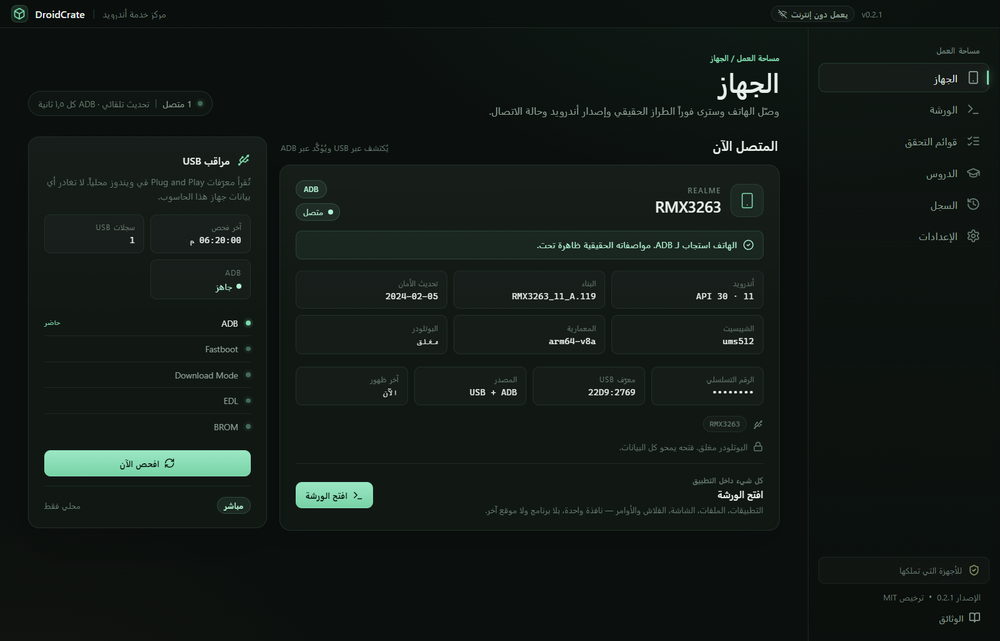
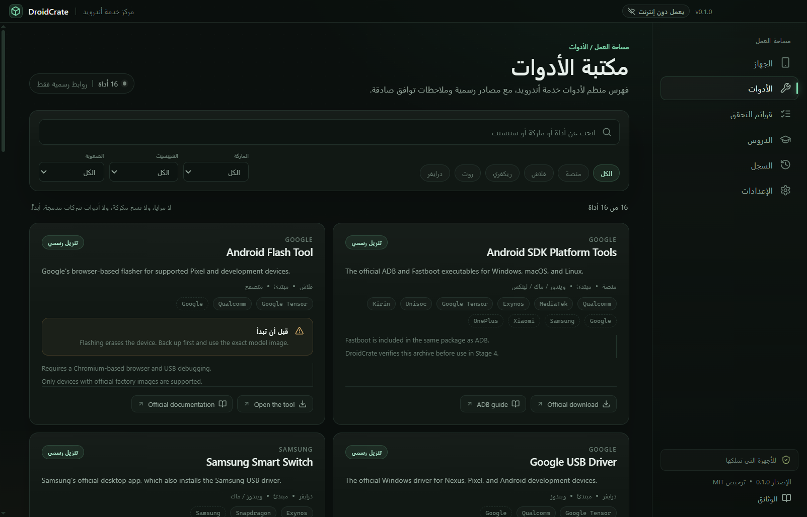
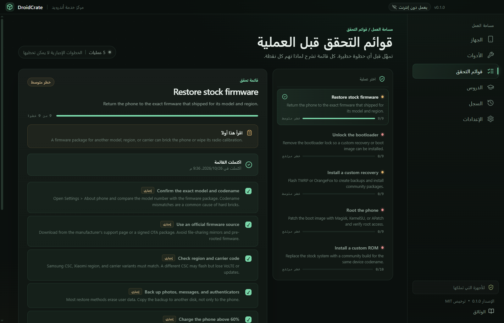
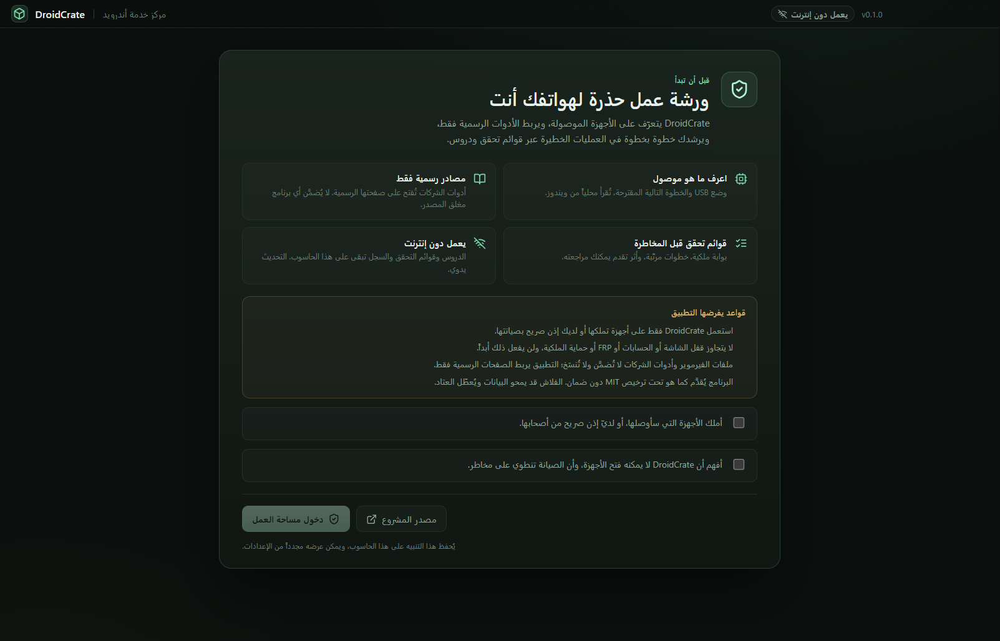
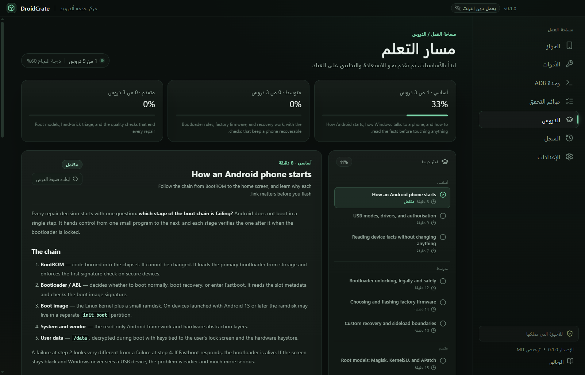
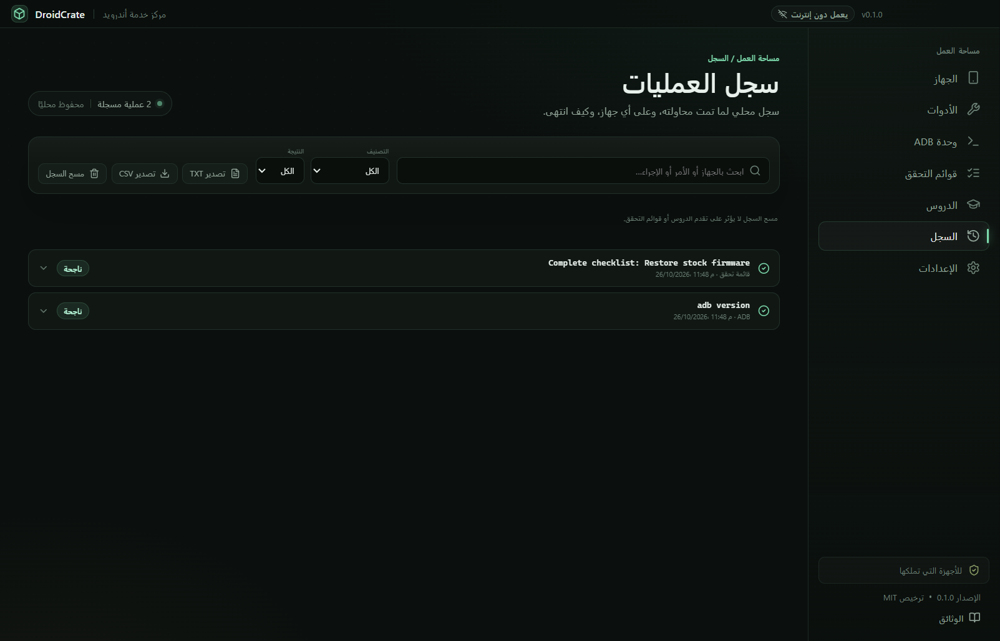
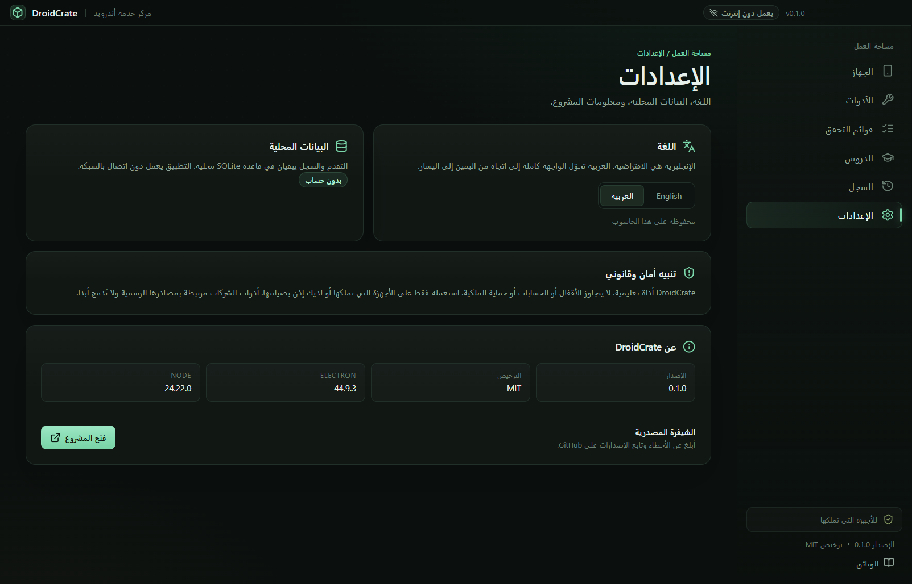

<p align="center">
  <a href="docs/banner.png"></a>
</p>

<h1 align="center">DroidCrate · درويد كريت</h1>

<p align="center">
  <strong>اعرف الهاتف. قبل أن تلمسه.</strong><br />
  مركز خدمة أندرويد مجاني ومفتوح المصدر لويندوز: كشف محلي عبر USB، روابط رسمية للأدوات، قوائم
  تحقق محمية، تسعة دروس، وعشر إجراءات ADB وFastboot ثابتة.
</p>

<p align="center">
  <a href="https://github.com/bouadjadjatamer2-hub/DroidCrate/releases/download/v0.1.0/DroidCrate-0.1.0-Setup.exe"></a>
</p>

<p align="center">
  <a href="https://github.com/bouadjadjatamer2-hub/DroidCrate"></a>
  <a href="https://github.com/bouadjadjatamer2-hub/DroidCrate/releases/tag/v0.1.0"></a>
  <a href="LICENSE"></a>
  <a href="https://github.com/bouadjadjatamer2-hub/DroidCrate/releases"></a>
  
</p>

<p align="center">
  <a href="#التثبيت">التثبيت</a> ·
  <a href="#المميزات">المميزات</a> ·
  <a href="#لقطات-الشاشة">لقطات الشاشة</a> ·
  <a href="#الأمان">الأمان</a> ·
  <a href="#كيف-يعمل">كيف يعمل</a> ·
  <a href="#البناء-من-المصدر">البناء من المصدر</a> ·
  <a href="#أسئلة-شائعة">أسئلة شائعة</a> ·
  <a href="README.md">English</a>
</p>

<a href="docs/screenshots/stage-1-device-ar.png"></a>

## لماذا DroidCrate؟

العمل على صيانة أندرويد مليء بالمرايا غير الرسمية، وأدوات الشركات المرفقة، وتعليمات تتخطى الخطوة
التي تتحقق فيها مما تحمله بين يديك. DroidCrate يفعل العكس: يتعرّف على الجهاز محلياً، يفتح المصدر
الرسمي، يبطئك قبل الخطوة الخطيرة، ويُبقي كل إجراء داخل جدول ثابت قابل للمراجعة.

هو ورشة عمل، لا صندوق سحري. يساعدك على قراءة الهاتف وتحضيره واتباع إجراء آمن. لا يفتحه، ولا
يفلّشه، ولا يمحوه، ولا يتجاوز حساباً.

## المميزات

| الميزة                            | ما تفعله                                                                                                                         |
| --------------------------------- | -------------------------------------------------------------------------------------------------------------------------------- |
| **اعرف ما هو موصول**              | يقرأ Plug and Play في ويندوز محلياً ويسمّي وضع USB: ADB أو Fastboot أو Download أو EDL أو BROM. يقترح الخطوة الرسمية التالية.    |
| **16 أداة بروابط رسمية فقط**      | فهرس منسّق لأدوات المنصّة والفلاش والتعريفات والاسترداد وإدارة الروت. بلا مرايا، بلا نسخ مكركة، وبلا برامج شركات مرفقة.          |
| **5 قوائم تحقق قبل العملية**      | 46 خطوة مرتّبة عبر الفيرموير الأصلي وفتح البوت لودر والاسترداد المخصص والروت والروم المخصص. كل خطوة مطلوبة يجب تعليمها.          |
| **10 إجراءات ADB/Fastboot ثابتة** | خمس استعلامات للقراءة فقط، وثلاث إعادات تشغيل تتطلب تأكيداً، وفحصان عبر Fastboot. الواجهة لا تستطيع إرسال أوامر حرّة.            |
| **Platform Tools موثّقة**         | يثبّت Platform Tools 37.0.1 من `dl.google.com`، ويتحقق من بصمة SHA-256 المثبّتة قبل فك الضغط، ويشغّل ADB من النسخة الموثّقة فقط. |
| **9 دروس واختبار**                | دروس للمستوى التأسيسي والمتوسط والمتقدم، بدرجة نجاح 60% وشرح لكل جواب. التقدّم يبقى على الجهاز.                                  |
| **سجل عمليات محلي**               | كل إجراء ADB وتثبيت Platform Tools وقائمة مكتملة يُسجَّل في SQLite محلي، مع بحث وفلترة وتصدير TXT/CSV.                           |
| **لغتان ويعمل دون إنترنت**        | واجهة إنجليزية وعربية كاملة باتجاه RTL. الدروس والقوائم والسجل تعمل بلا اتصال؛ تحديث المحتوى يدوي وموثّق.                        |
| **بلا حساب وبلا تتبّع**           | بلا تسجيل، بلا تحليلات، بلا مزامنة سحابية. التطبيق يتصل بـ GitHub فقط عندما تطلب منه فحص تحديث المحتوى.                          |

## لقطات الشاشة

<table>
  <tr>
    <td width="50%">
      <a href="docs/screenshots/stage-2-tools-ar.png"></a>
      <br /><sub><b>مصادر رسمية فقط.</b> ست عشرة أداة مع فلاتر العلامة والشريحة ومستوى الصعوبة — وبلا مرايا.</sub>
    </td>
    <td width="50%">
      <a href="docs/screenshots/stage-3-checklists-ar.png"></a>
      <br /><sub><b>تمهّل قبل الخطر.</b> خمس عمليات، و46 خطوة مطلوبة، ومستوى خطر على كل واحدة.</sub>
    </td>
  </tr>
  <tr>
    <td width="50%">
      <a href="docs/screenshots/stage-8-welcome-ar.png"></a>
      <br /><sub><b>بوابة الملكية.</b> أول تشغيل يطلب تأكيد ملكية الأجهزة وفهم الحدود قبل الدخول.</sub>
    </td>
    <td width="50%">
      <a href="docs/screenshots/stage-5-lessons-ar.png"></a>
      <br /><sub><b>تعلّم السلسلة.</b> تسعة دروس تشرح كل مرحلة من إقلاع أندرويد — ومتى تتوقف.</sub>
    </td>
  </tr>
  <tr>
    <td width="50%">
      <a href="docs/screenshots/stage-6-history-ar.png"></a>
      <br /><sub><b>كل شيء مسجّل.</b> ابحث وفلتر وصدّر ما جُرّب، على أي جهاز، وكيف انتهى.</sub>
    </td>
    <td width="50%">
      <a href="docs/screenshots/stage-0-settings-ar.png"></a>
      <br /><sub><b>إنجليزي وعربي.</b> الواجهة كلها تنقلب إلى RTL؛ التقدّم والسجل لا يتركان الجهاز.</sub>
    </td>
  </tr>
</table>

## الأمان

DroidCrate مبني على قاعدة واحدة: الأداة يجب أن تبطئك قبل الخطوة الخطيرة، لا أن تجعل الخطوات
الخطيرة أسهل للوصول.

- **بلا تجاوزات، أبداً.** لا يستطيع إزالة قفل شاشة، ولا تجاوز حساب أو FRP، ولا كسر حماية ملكية.
  لا يوجد أمر مخفي أو إضافة أو نسخة بناء تضيف ذلك.
- **بلا فلاش أو محو أو فتح قفل.** يفتح أداة الشركة الرسمية ويشرح العملية؛ لكنه لا ينفّذ الفلاش.
- **بلا صدفة حرّة.** الواجهة تطلب إجراءً من جدول ثابت في
  [`src/shared/adb.ts`](src/shared/adb.ts) فقط. لا يوجد مربّع نص لـ `adb shell`.
- **بوابة الملكية.** أول تشغيل يطلب تأكيد أنك تملك الأجهزة التي ستوصلها. وكل قائمة تحقق عالية
  الخطورة تطلب التأكيد مرة أخرى قبل أن تُفتح.
- **مصادر رسمية فقط.** أدوات الشركات تُفتح على صفحة الشركة نفسها. الفيرموير والمثبّتات لا
  تُضمَّن ولا تُنسخ إلى مرايا.
- **الإقرار بالملكية ليس تحققاً.** الضمانة الحقيقية هي جدول الأوامر المغلق وغياب قدرات التجاوز —
  لا مربّع الاختيار.

## التثبيت

### ويندوز 10 / 11 · 64-bit

1. نزّل **[DroidCrate-0.1.0-Setup.exe](https://github.com/bouadjadjatamer2-hub/DroidCrate/releases/download/v0.1.0/DroidCrate-0.1.0-Setup.exe)** (117.6 ميغابايت).
2. شغّل المثبّت. الملف غير موقّع، لذا قد يُنبّهك Windows SmartScreen — اختر **More info → Run anyway**، أو ابنِ من المصدر.
3. عند أول تشغيل، اقرأ التنبيه، أكّد الملكية، ثم ادخل ورشة العمل.
4. وصّل هاتفاً بكابل USB يدعم نقل البيانات. لـ ADB، فعّل **تصحيح USB** واقبل التنبيه على الهاتف.

المثبّت لكل مستخدم، ويسمح باختيار المجلد، وينشئ اختصاراً على سطح المكتب.

### Platform Tools

ADB وFastboot غير مضمّنين. وحدة ADB تنزّل **Android SDK Platform Tools 37.0.1** (نحو 8 ميغابايت)
من `dl.google.com`، وتتحقق من بصمة SHA-256 المثبّتة، ثم تفكّ الضغط داخل مجلد بيانات التطبيق.
التنزيل مطلوب مرة واحدة؛ بعدها تعمل الوحدة دون إنترنت.

### تحقّق من التنزيل

```powershell
Get-FileHash .\DroidCrate-0.1.0-Setup.exe -Algorithm SHA256
```

بصمة SHA-256 للإصدار `v0.1.0`:

```text
8C785FBAFFD9F9472082BD87F84C634DB077616FD4CBB4F0529008DE8529789C
```

## كيف يعمل

```text
Plug and Play في ويندوز ──► وضع USB ──► الأداة أو القائمة المقترحة
                                         │
                               جدول الإجراءات الثابت ──► adb / fastboot
                                         │
                                  سجل SQLite محلي
```

1. DroidCrate يقرأ معرّفات USB من ويندوز. لا شيء يُرسل إلى أي مكان.
2. القواعد في `data/devices.json` تحوّل تلك المعرّفات إلى وضع والخطوة التالية المقترحة.
3. بوابة القوائم تسجّل الإقرار بالملكية والخطوات المطلوبة.
4. المعالج الرئيسي يحوّل كل إجراء ADB أو Fastboot من جدول ثابت. الواجهة لا تستطيع تمرير أوامر حرّة.
5. النتائج والمدد والأخطاء تُكتب في قاعدة السجل المحلية.

تحديث المحتوى اختياري ويدوي: التطبيق يفحص البيان الرسمي من المستودع، ويتحقق من SHA-256 والمخطط،
ثم يثبّت التحديث ذرّياً. إذا فشل أي شيء، يُستعاد المحتوى المضمّن ويبقى التطبيق يعمل دون إنترنت.

## حدود صريحة

- **المثبّت غير موقّع.** لا توجد شهادة توقيع بعد، لذا قد يطلب SmartScreen تأكيداً.
- **ويندوز x64 فقط.** لا توجد حزمة ARM64 بعد.
- **كشف الأجهزة يعتمد على تعريفات ويندوز.** هاتف بلا تعريف مناسب قد لا يظهر، أو يظهر باسم عام. جهاز واحد فقط (Realme RMX3263) اختُبر عند الإصدار.
- **ADB يحتاج تفويضاً على الهاتف.** أول اتصال يتطلب «السماح بتصحيح USB»؛ لا دعم لـ ADB اللاسلكي.
- **Platform Tools تحتاج تنزيلاً واحداً.** نحو 8 ميغابايت من Google؛ ولا توجد مرآة بقصد.
- **المحتوى التقني بالإنجليزية.** الواجهة ثنائية اللغة، لكن الدروس وخطوات القوائم مكتوبة بالإنجليزية.
- **السجل يعرض آخر 500 صف.** الصفوف الأقدم تبقى في القاعدة لكنها لا تُعرض بعد.
- **القائمة إرشاد، لا ضمان.** الفلاش قد يمحو البيانات أو يُعطّل العتاد رغم اتباع الخطوات.

## البناء من المصدر

المتطلبات: **Node.js 22+** و**npm**، وويندوز 10/11 لبناء نسخة ويندوز.

```powershell
git clone https://github.com/bouadjadjatamer2-hub/DroidCrate.git
cd DroidCrate
npm install
npm run dev
```

| الأمر                      | ما يفعله                                   |
| -------------------------- | ------------------------------------------ |
| `npm run dev`              | تشغيل التطبيق في وضع التطوير               |
| `npm run typecheck`        | فحص أنواع المعالج والواجهة                 |
| `npm test`                 | تشغيل اختبارات الوحدة                      |
| `npm run test:e2e`         | تشغيل اختبارات Playwright الشاملة          |
| `npm run build`            | بناء نسخة الإنتاج                          |
| `npm run build:win`        | بناء مثبّت ويندوز                          |
| `npm run content:manifest` | إعادة توليد بيان المحتوى بعد تعديل `data/` |

خطوات الإصدار والبصمات والتراجع في [docs/RELEASE.md](docs/RELEASE.md). تاريخ البناء موثّق في
[docs/STAGES.md](docs/STAGES.md).

## أسئلة شائعة

<details>
<summary><b>هل DroidCrate أداة فلاش؟</b></summary>
لا. يفتح أداة الفلاش الرسمية ويمرّرك عبر قائمة تحقق، لكنه لا ينفّذ الفلاش نفسه. الفلاش والمحو
وفتح القفل والتجاوز خارج جدول أوامره.
</details>

<details>
<summary><b>هل يستطيع إزالة قفل الشاشة أو FRP أو حساب Samsung/Google؟</b></summary>
لا، ولن يفعل. المشروع يعتبر هذه الطلبات خارج النطاق: تُستعمل غالباً على أجهزة مفقودة أو مسروقة،
والتطبيق لا يستطيع التحقق من الملكية. لا توجد ميزة مخفية لهذا.
</details>

<details>
<summary><b>هل يعمل الروت على هاتفي؟</b></summary>
لا. يشرح نماذج الروت الثلاثة الشائعة (Magisk وKernelSU وAPatch) ويربط صفحاتها الرسمية. التعديل
والفلاش الفعليان يبقيان يدويين، والتطبيق لا يشغّل تلك الأوامر.
</details>

<details>
<summary><b>هل يعمل دون إنترنت؟</b></summary>
نعم، بعد التثبيت. الدروس والقوائم وقواعد الأجهزة والسجل مضمّنة أو محلية. الميزتان اللتان
تحتاجان الشبكة هما تنزيل Platform Tools مرة واحدة، وتحديث المحتوى الاختياري.
</details>

<details>
<summary><b>هل يجمع تتبّعاً؟</b></summary>
لا. لا حساب، ولا تحليلات، ولا مزامنة سحابية. التقدّم والسجل في قاعدة SQLite محلية عند
`%APPDATA%\droidcrate\droidcrate.db`.
</details>

<details>
<summary><b>ما الهواتف المدعومة؟</b></summary>
أي هاتف أندرويد يراه ويندوز عبر USB. قواعد الأجهزة تغطي معرّفات الشركات الشائعة، ويمكنك توسيع
`data/devices.json`. الكشف تقديري: تعريف ناقص قد يخفي الجهاز.
</details>

<details>
<summary><b>لماذا يحذّرني SmartScreen؟</b></summary>
المثبّت غير موقّع رقمياً. ويندوز لا يستطيع التحقق من الناشر، فيطلب منك التأكيد. تحقق من بصمة
SHA-256 أعلاه، أو ابنِ من المصدر.
</details>

<details>
<summary><b>هل الاستعمال التجاري مسموح؟</b></summary>
الشيفرة تحت رخصة MIT. استعملها على أجهزة تملكها أو لديك إذن صريح بصيانتها، وأبقِ تنبيه الأمان
كما هو.
</details>

## المساهمة

تقارير الأخطاء وقواعد الأجهزة وتصحيحات الدروس والترجمات مرحّب بها. اقرأ
[CONTRIBUTING.md](CONTRIBUTING.md) أولاً، وافتح issue قبل تغيير كبير. تقارير الأمان تتبع
[SECURITY.md](SECURITY.md). أسماء الأطراف الثالثة وحدودها في [NOTICE.md](NOTICE.md).

## الرخصة

DroidCrate منشور تحت [رخصة MIT](LICENSE). أسماء الأدوات والعلامات التجارية ملك لأصحابها،
وتُذكر هنا للتعريف فقط.

---

<p align="center">
  <sub>من نفس الورشة: <a href="https://github.com/bouadjadjatamer2-hub/Majra"><b>مجرى</b></a> — مدير تنزيلات يستعمل كل اتصالات الشبكة التي عندك.</sub>
</p>
