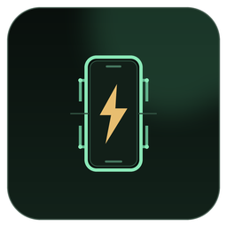
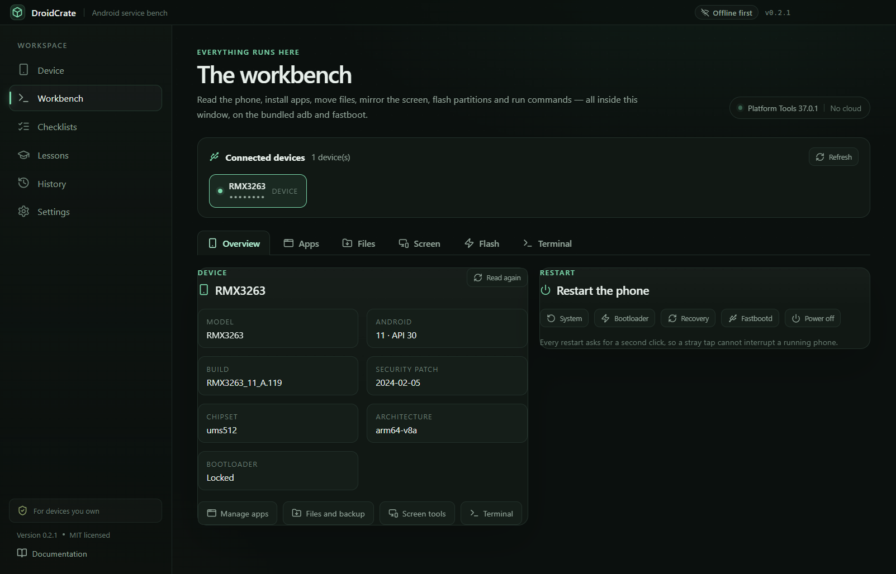
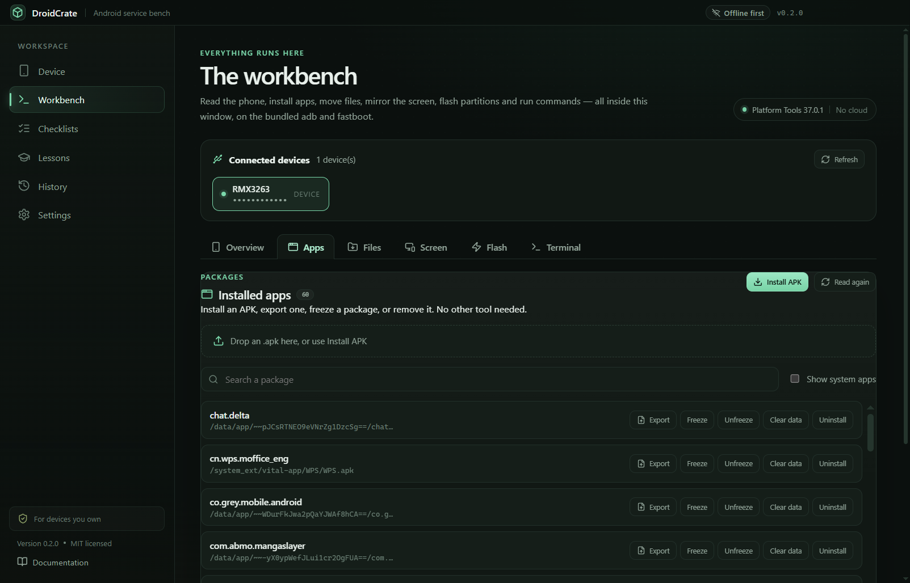
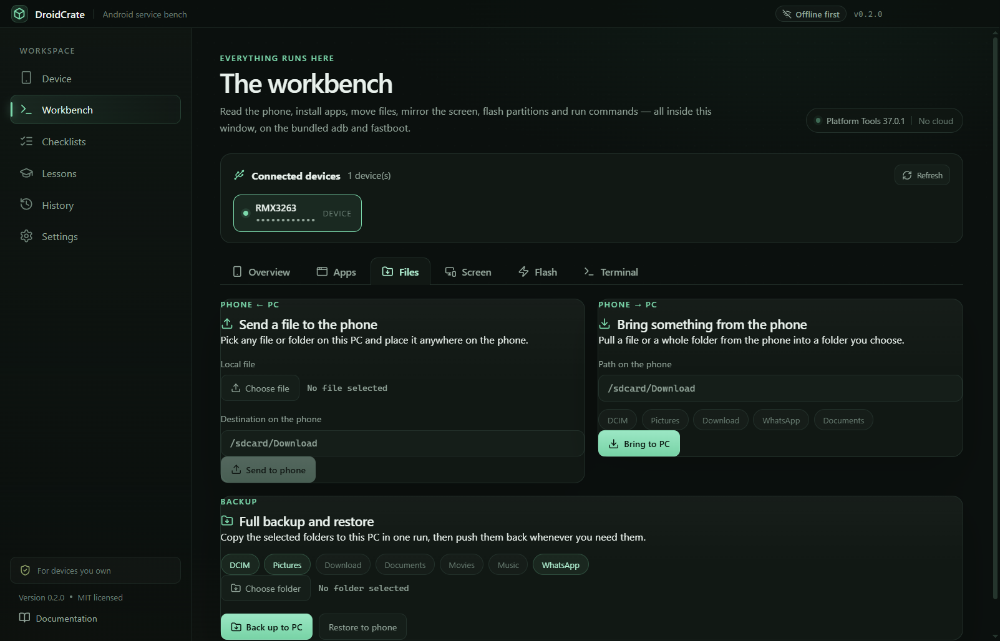
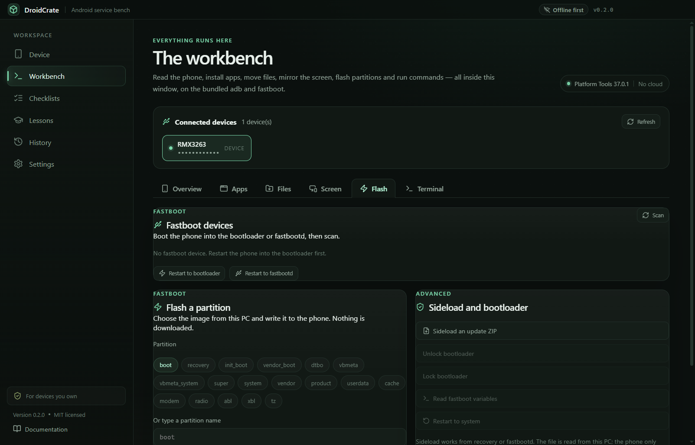
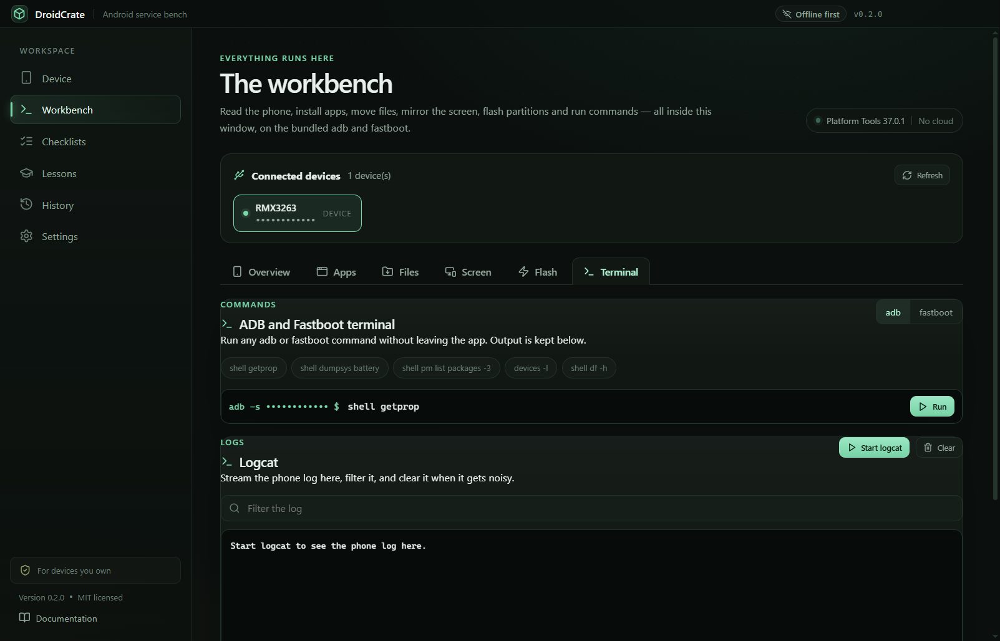

<p align="center">
  <a href="docs/banner.png"></a>
</p>

<p align="center">
  
</p>

<h1 align="center">DroidCrate</h1>

<p align="center">
  <strong>Everything you need for the phone, in one window.</strong><br />
  A free, open-source Android workbench for Windows: install apps, move files, mirror the screen,
  flash partitions and run adb or fastboot commands — without opening another program or website.
</p>

<p align="center">
  <a href="https://github.com/bouadjadjatamer2-hub/DroidCrate/releases/download/v0.2.1/DroidCrate-0.2.1-Setup.exe"></a>
</p>

<p align="center">
  <a href="https://github.com/bouadjadjatamer2-hub/DroidCrate"></a>
  <a href="https://github.com/bouadjadjatamer2-hub/DroidCrate/releases/tag/v0.2.1"></a>
  <a href="LICENSE"></a>
  <a href="https://github.com/bouadjadjatamer2-hub/DroidCrate/releases"></a>
  
</p>

<p align="center">
  <a href="#install">Install</a> ·
  <a href="docs/USER-GUIDE.md">User guide</a> ·
  <a href="#the-workbench">The workbench</a> ·
  <a href="#screenshots">Screenshots</a> ·
  <a href="#safety">Safety</a> ·
  <a href="#how-it-works">How it works</a> ·
  <a href="#build-from-source">Build from source</a> ·
  <a href="#faq">FAQ</a> ·
  <a href="README.ar.md">العربية</a>
</p>

<a href="docs/screenshots/workbench-overview-en.png"></a>

## Why DroidCrate

Most Android tasks are scattered across five different programs, three websites and a folder of
remembered command lines. DroidCrate puts them in one place: a single workbench that talks to the
phone over USB, reads it, and does the job with the adb and fastboot binaries it installs once.

You pick the files from your own PC. The app never sends you to a download site, never opens another
program, and never needs an account.

## The workbench

One screen, six tabs. The phone stays connected while you move between them.

| Tab            | What you can do                                                                                                                                                                       |
| -------------- | ------------------------------------------------------------------------------------------------------------------------------------------------------------------------------------- |
| **Overview**   | Read the model, Android version, build, security patch, chipset and bootloader state. Restart to system, bootloader, recovery, fastbootd or power off — each with a second-click guard. |
| **Apps**       | List every installed package, install an APK by picking it or dropping it on the window, export an APK to the PC, freeze/unfreeze a package, clear its data, or uninstall it.          |
| **Files**      | Send any file from the PC to any phone path, pull a file or folder back, and run a full backup/restore of DCIM, Pictures, Download, Documents, Movies, Music and WhatsApp.             |
| **Screen**     | Take a PNG screenshot, record up to three minutes of MP4, or open a live view of the phone and tap it directly from the window.                                                       |
| **Flash**      | Pick a local boot/recovery/system image and flash it in fastboot, erase a partition, sideload an OTA ZIP from the PC, unlock or lock the bootloader, and read fastboot variables.       |
| **Terminal**   | Run any adb or fastboot command with presets, and stream logcat with a live text filter.                                                                                              |

Everything above runs on the bundled Platform Tools. There is no second app to install, no external
tool page, and no in-app ROM browser: you choose the image or ZIP from your own disk.

## Features

| Feature                            | What it does                                                                                                                                          |
| ---------------------------------- | ----------------------------------------------------------------------------------------------------------------------------------------------------- |
| **One workbench, six tools**       | Apps, files, screen, flashing, commands and device information in a single window, with one device picker shared by every tab.                         |
| **Real APK management**            | Install from a file picker or drag-and-drop, export any installed APK, freeze, unfreeze, clear data and uninstall — all through `pm` with safe arguments. |
| **Files and full backup**          | Push and pull files or folders with progress, then copy the usual phone folders to the PC and restore them later in one run.                            |
| **Screen capture and live view**   | Screenshot, screen recording, and a live view that refreshes about once per second; click the image to tap, and use Back, Home, Recents and Power.     |
| **Fastboot flashing from local files** | Flash any partition from an image on your PC, erase a partition, sideload an update ZIP, and lock or unlock the bootloader. Nothing is downloaded.   |
| **ADB and Fastboot terminal**      | A real command box with presets, output, exit status and duration, plus a streaming logcat with filter and clear.                                      |
| **Know what is connected**         | Reads Windows Plug and Play locally and names the USB mode: ADB, Fastboot, Download, EDL or BROM.                                                     |
| **Verified Platform Tools**        | Installs Google's Platform Tools 37.0.1 from `dl.google.com`, checks the pinned SHA-256 before extraction, and runs adb only from that verified copy.  |
| **5 pre-flight checklists**        | 46 ordered steps across stock firmware, bootloader unlock, custom recovery, root and custom ROM. Every required step must be checked.                 |
| **9 lessons and a quiz**           | Foundation, intermediate and advanced lessons with a 60% pass mark and an explanation for every answer. Progress stays on the PC.                     |
| **Local operation history**        | Every command, install, backup, flash and completed checklist is recorded locally, with search, filters and TXT/CSV export.                           |
| **Bilingual and offline-first**    | English and a full Arabic RTL interface. The workbench, lessons, checklists and history work without a connection.                                    |
| **No account, no telemetry**       | No sign-up, no analytics, no cloud sync. The app contacts GitHub only when you ask it to check for content updates.                                   |

## Screenshots

<table>
  <tr>
    <td width="50%">
      <a href="docs/screenshots/workbench-apps-en.png"></a>
      <br /><sub><b>Apps without another tool.</b> Install, export, freeze, clear or uninstall any package.</sub>
    </td>
    <td width="50%">
      <a href="docs/screenshots/workbench-files-en.png"></a>
      <br /><sub><b>Move everything.</b> Send a file, pull a folder, or back up the usual phone folders in one run.</sub>
    </td>
  </tr>
  <tr>
    <td width="50%">
      <a href="docs/screenshots/workbench-flash-en.png"></a>
      <br /><sub><b>Flash from your own disk.</b> Pick the image, pick the partition, confirm once — no download page.</sub>
    </td>
    <td width="50%">
      <a href="docs/screenshots/workbench-terminal-en.png"></a>
      <br /><sub><b>Commands and logs.</b> Run adb or fastboot directly, then watch logcat update in the same window.</sub>
    </td>
  </tr>
  <tr>
    <td width="50%">
      <a href="docs/screenshots/stage-3-checklists.png"></a>
      <br /><sub><b>Slow down before risk.</b> Five operations, 46 required steps, and a risk level on each one.</sub>
    </td>
    <td width="50%">
      <a href="docs/screenshots/stage-5-lessons.png"></a>
      <br /><sub><b>Learn the chain.</b> Nine lessons explain what each stage of an Android boot does — and when to stop.</sub>
    </td>
  </tr>
</table>

## Safety

DroidCrate gives you real tools, so the guard rails are explicit:

- **No bypasses, ever.** It cannot remove a screen lock, bypass an account or FRP, or defeat
  ownership protection. There is no hidden command, plugin or build that adds this.
- **Flashing is a deliberate act.** The Flash tab only works with a fastboot device and a local image
  you selected, and it asks for a confirmation checkbox before every write. DroidCrate never
  downloads firmware and never guesses a partition.
- **Erase and unlock are gated.** Erasing a partition and locking or unlocking the bootloader each
  require a second click.
- **Commands are visible.** The terminal shows the exact command, its output, exit status and
  duration, and every command is written to the local history.
- **Ownership gate.** First launch asks you to confirm that you own the devices you will connect.
  Every high-risk checklist asks again before it opens.
- **Nothing leaves the PC.** No telemetry, no account, no cloud. The only network calls are the
  one-time Platform Tools download and the optional content update.

## Install

### Windows 10 / 11 · 64-bit

1. Download **[DroidCrate-0.2.1-Setup.exe](https://github.com/bouadjadjatamer2-hub/DroidCrate/releases/download/v0.2.1/DroidCrate-0.2.1-Setup.exe)** (117.6 MB).
2. Run the installer. It is unsigned, so Windows SmartScreen may warn you — choose **More info → Run anyway**, or build from source.
3. On first launch, read the notice and confirm ownership.
4. Connect a phone with a data-capable USB cable. For ADB, enable **USB debugging** and accept the prompt on the phone.

The installer is per-user, lets you choose the folder, and creates a desktop shortcut.

New to the app? The **[user guide](docs/USER-GUIDE.md)** walks through every tab step by step:
connect the phone, install and freeze apps, move files, capture the screen, flash a partition and run
adb or fastboot commands.

### Platform Tools

ADB and Fastboot are installed once from **Android SDK Platform Tools 37.0.1** (about 8 MB) from
`dl.google.com`. DroidCrate checks the pinned SHA-256 before extracting, then runs adb and fastboot
only from that verified copy. After the one-time download, the whole workbench works offline.

### Verify the download

```powershell
Get-FileHash .\DroidCrate-0.2.1-Setup.exe -Algorithm SHA256
```

The SHA-256 for `v0.2.1` is:

```text
AB714C54412CC396F3D4F5154FE3817D0099049350754565346A1B24EC08123A
```

## How it works

```text
USB device ──► workbench tab ──► validated adb / fastboot command ──► phone
                                        │
                                 local history (SQLite)
```

1. DroidCrate reads USB identifiers from Windows and lists the phone in the workbench.
2. The renderer asks for a typed operation (install, pull, flash, command) — it never spawns a shell.
3. The main process validates every argument, resolves the bundled adb or fastboot path, and runs it.
4. Output, duration and errors are streamed back to the tab and written to the local history.

Content updates are optional and manual: the app checks the official manifest from the repository,
validates SHA-256 and the schema, then installs atomically. If anything fails, the bundled content
is restored and the app keeps working offline.

## Honest limits

- **The installer is unsigned.** There is no code-signing certificate yet, so SmartScreen may ask you to confirm.
- **Windows x64 only.** There is no ARM64 build yet.
- **Live view is a fast screenshot loop, not a video stream.** It refreshes about once per second and is meant for checking and tapping, not for watching video on the phone.
- **Screen recording stops at three minutes.** Android's `screenrecord` limit; start a second recording for longer clips.
- **Device detection depends on Windows drivers.** A phone without a proper driver may not appear, or may appear with a generic name. Only one device (Realme RMX3263) was tested at release.
- **ADB needs authorisation on the phone.** The first connection requires "Allow USB debugging"; wireless ADB is not supported yet.
- **Platform Tools need one download.** About 8 MB from Google; after that everything works offline.
- **The technical content is English.** The interface is bilingual, but lessons and checklist steps are written in English.
- **History shows the latest 500 rows.** Older rows stay in the database but are not displayed yet.
- **Flashing can still erase data or brick hardware.** A wrong image or the wrong partition is not recoverable by the app.

## Build from source

Requirements: **Node.js 22+**, **npm**, and Windows 10/11 for the Windows build.

```powershell
git clone https://github.com/bouadjadjatamer2-hub/DroidCrate.git
cd DroidCrate
npm install
npm run dev
```

| Command                    | What it does                                          |
| -------------------------- | ----------------------------------------------------- |
| `npm run dev`              | Start the app in development mode                     |
| `npm run typecheck`        | Type-check the main and renderer code                 |
| `npm test`                 | Run the unit tests                                    |
| `npm run test:e2e`         | Run the Playwright end-to-end suite                   |
| `npm run build`            | Build the production app                              |
| `npm run build:win`        | Build the Windows installer                           |
| `npm run content:manifest` | Regenerate the content manifest after editing `data/` |

Release steps, checksums and rollback notes live in [docs/RELEASE.md](docs/RELEASE.md). The build
history is documented in [docs/STAGES.md](docs/STAGES.md), and end-user instructions in
[docs/USER-GUIDE.md](docs/USER-GUIDE.md).

## FAQ

<details>
<summary><b>Is DroidCrate a flashing tool?</b></summary>
Yes, for images you already have. The Flash tab writes a boot, recovery, system or any other partition
from a file on your PC, and it can sideload an update ZIP. It never downloads firmware and it will not
help you bypass a lock or an account.
</details>

<details>
<summary><b>Do I need to install adb, fastboot or another program?</b></summary>
No. DroidCrate installs the official Google Platform Tools once, verifies the SHA-256, and uses that
copy for every tab. You do not need a separate terminal, flasher or file manager.
</details>

<details>
<summary><b>Can it remove a screen lock, FRP, or a Samsung/Google account?</b></summary>
No, and it never will. The project treats those requests as out of scope: they are commonly used on
lost or stolen devices, and an app cannot verify ownership. There is no hidden feature for this.
</details>

<details>
<summary><b>Does it root my phone?</b></summary>
No. It explains the three common root models (Magisk, KernelSU and APatch) and links their official
pages. Patching and flashing a rooted boot image is something you do deliberately in the Flash tab.
</details>

<details>
<summary><b>Does it work without internet?</b></summary>
Yes, after installation. The workbench, lessons, checklists, device rules and history are bundled or
local. The two network features are the one-time Platform Tools download and the optional content
update.
</details>

<details>
<summary><b>Does it collect telemetry?</b></summary>
No. There is no account, no analytics and no cloud sync. Progress and history live in a local SQLite
database at `%APPDATA%\droidcrate\droidcrate.db`.
</details>

<details>
<summary><b>Which phones are supported?</b></summary>
Any Android phone that Windows can see over USB. The device rules cover the common vendor IDs, and
you can extend `data/devices.json`. Detection is best-effort: a missing driver can hide a device.
</details>

<details>
<summary><b>Why does SmartScreen warn me?</b></summary>
The installer is not code-signed. Windows cannot verify the publisher, so it asks you to confirm.
Check the SHA-256 above, or build from source.
</details>

<details>
<summary><b>Is commercial use allowed?</b></summary>
The code is MIT-licensed. Use it on devices you own or are explicitly authorised to service, and
keep the safety notice intact.
</details>

## Contributing

Bug reports, device rules, lesson corrections and translations are welcome. Read
[CONTRIBUTING.md](CONTRIBUTING.md) first, and open an issue before a large change. Security reports
should follow [SECURITY.md](SECURITY.md). Third-party names and boundaries are listed in
[NOTICE.md](NOTICE.md).

## License

DroidCrate is released under the [MIT License](LICENSE). Tool names and trademarks belong to their
owners and are referenced for identification only.

---

<p align="center">
  <sub>Also from the same workbench: <a href="https://github.com/bouadjadjatamer2-hub/Majra"><b>Majra</b></a> — a download manager that uses every network connection you have.</sub>
</p>
