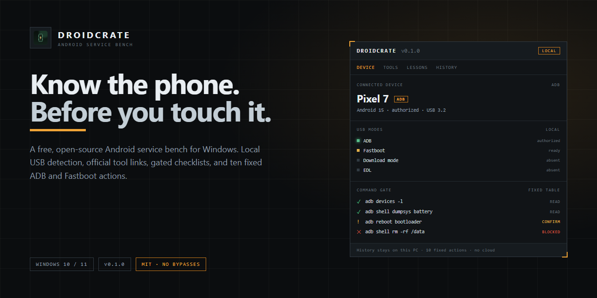
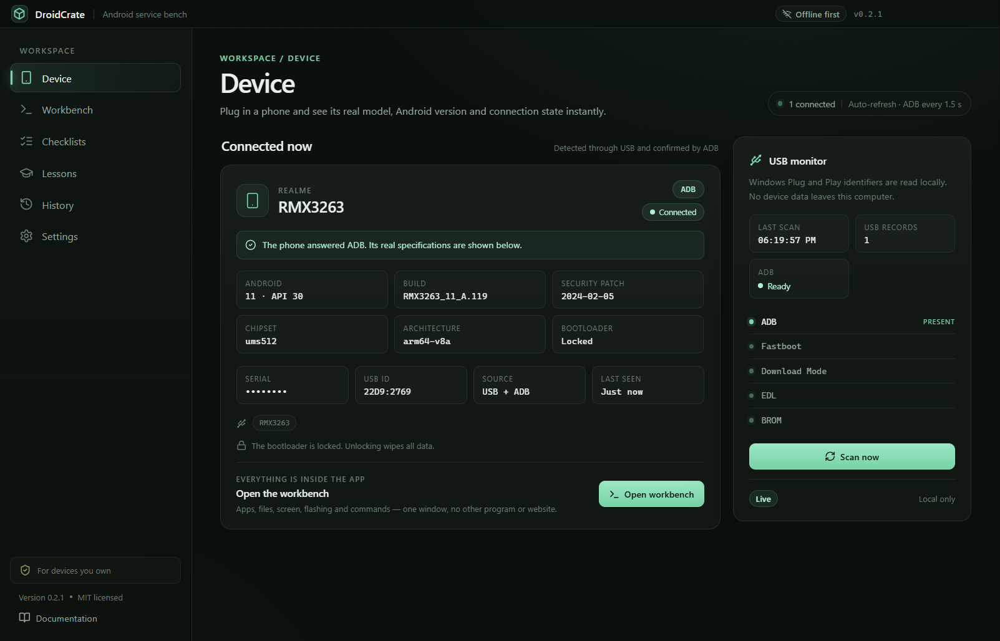
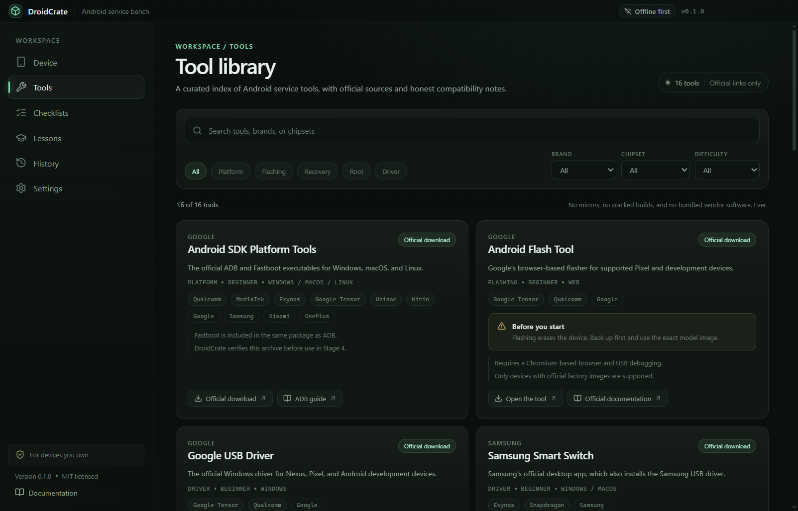
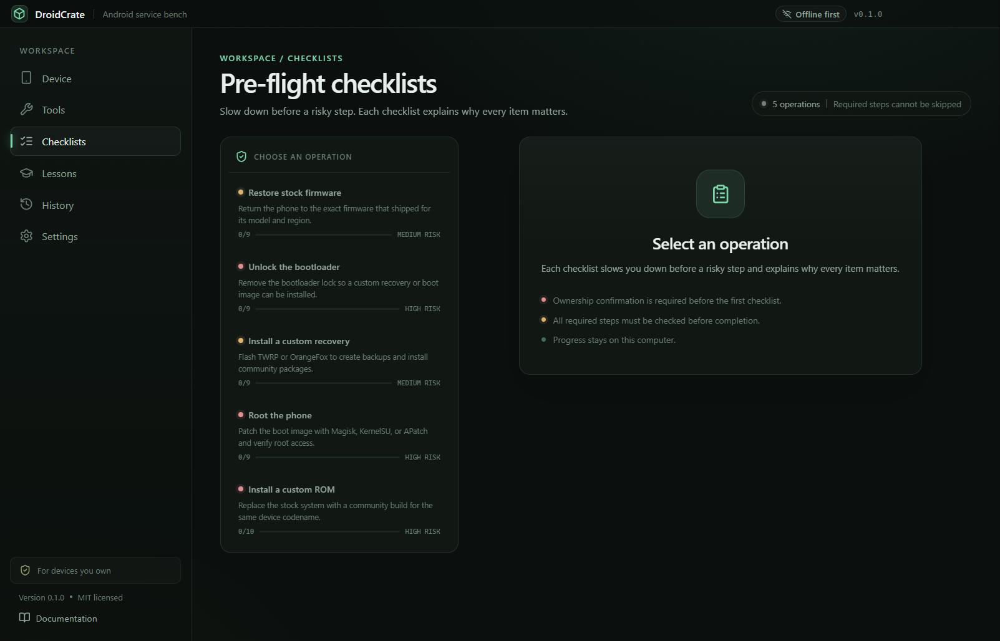
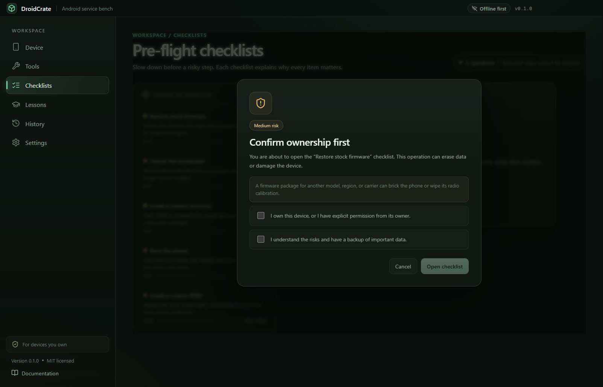
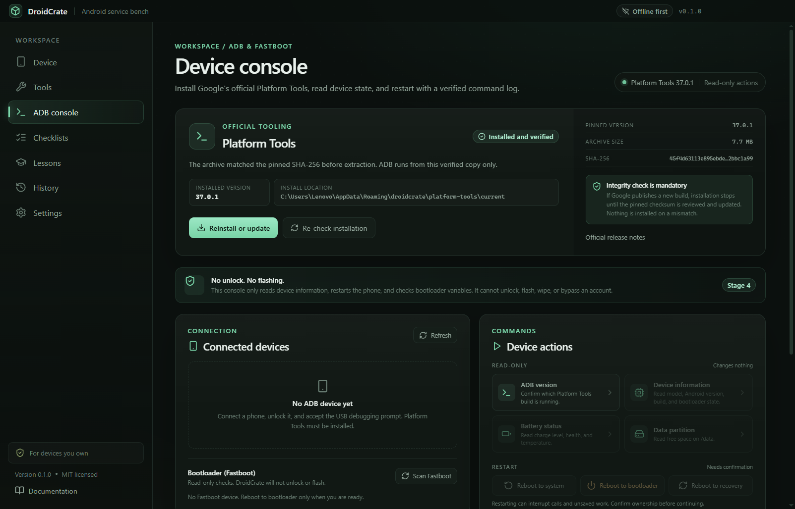
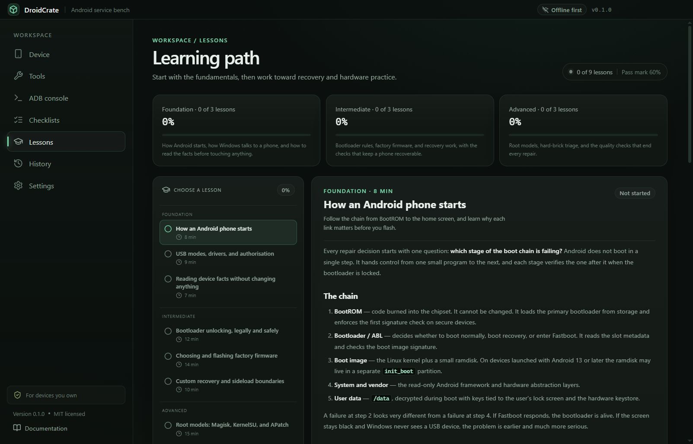
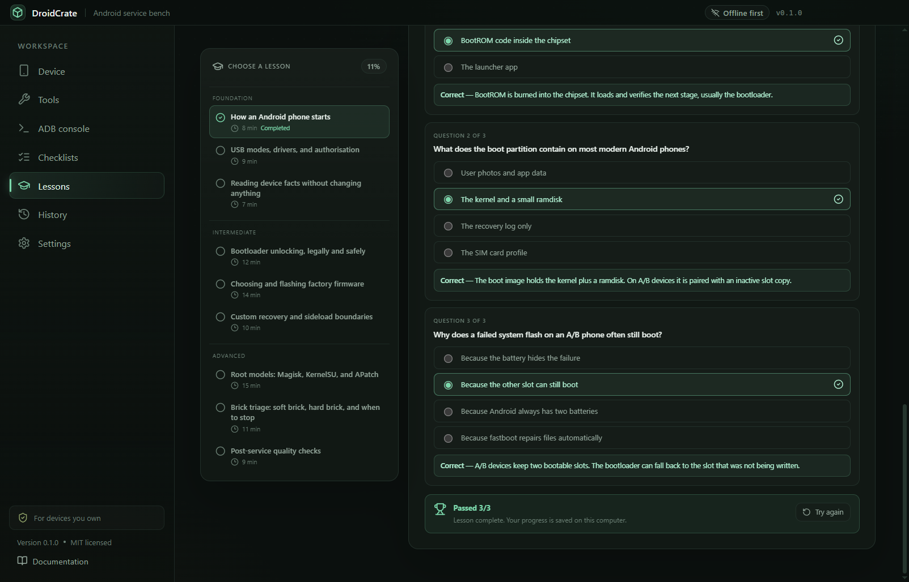
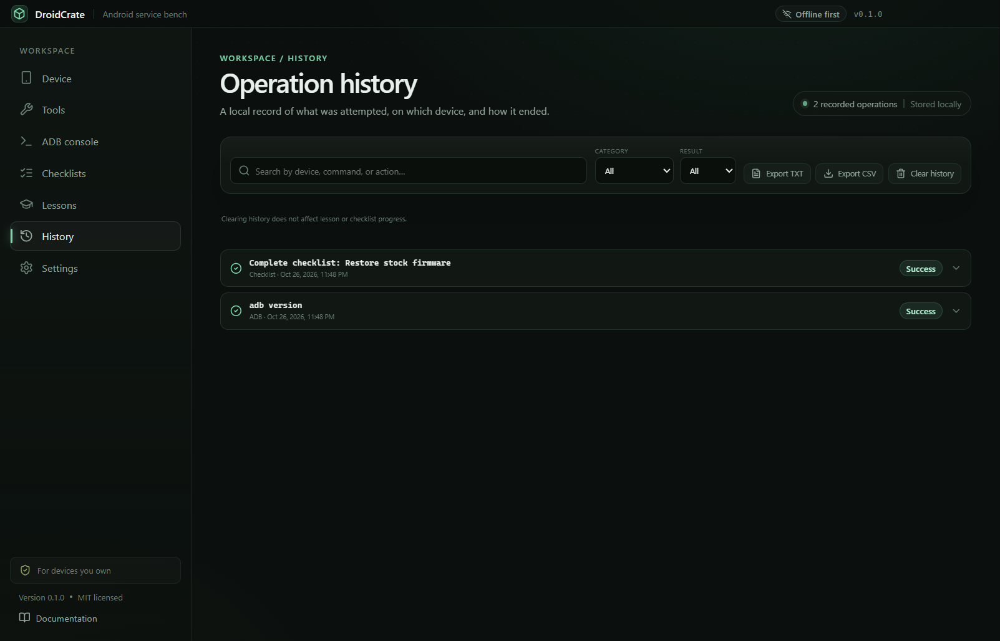
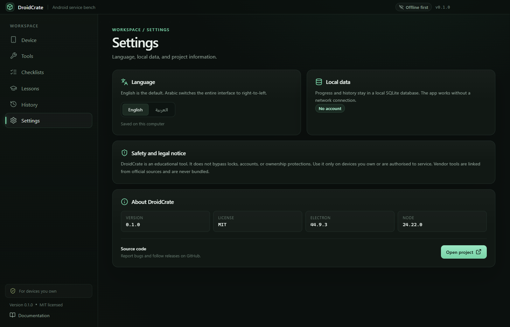

<p align="center">
  <a href="docs/banner.png"></a>
</p>

<h1 align="center">DroidCrate</h1>

<p align="center">
  <strong>Know the phone. Before you touch it.</strong><br />
  A free, open-source Android service bench for Windows: local USB detection, official tool links,
  gated checklists, nine lessons, and ten fixed ADB and Fastboot actions.
</p>

<p align="center">
  <a href="https://github.com/bouadjadjatamer2-hub/DroidCrate/releases/download/v0.1.0/DroidCrate-0.1.0-Setup.exe"></a>
</p>

<p align="center">
  <a href="https://github.com/bouadjadjatamer2-hub/DroidCrate"></a>
  <a href="https://github.com/bouadjadjatamer2-hub/DroidCrate/releases/tag/v0.1.0"></a>
  <a href="LICENSE"></a>
  <a href="https://github.com/bouadjadjatamer2-hub/DroidCrate/releases"></a>
  
</p>

<p align="center">
  <a href="#install">Install</a> ·
  <a href="#features">Features</a> ·
  <a href="#screenshots">Screenshots</a> ·
  <a href="#safety">Safety</a> ·
  <a href="#how-it-works">How it works</a> ·
  <a href="#build-from-source">Build from source</a> ·
  <a href="#faq">FAQ</a> ·
  <a href="README.ar.md">العربية</a>
</p>

<a href="docs/screenshots/stage-1-device.png"></a>

## Why DroidCrate

Android service work is full of unofficial mirrors, bundled vendor tools, and instructions that
skip the part where you check what you are actually holding. DroidCrate takes the opposite approach:
identify the device locally, open the official source, slow down before a risky step, and keep every
action inside a fixed, reviewable table.

It is a workbench, not a magic box. It will help you read a phone, prepare it, and follow a safe
procedure. It will not unlock it, flash it, wipe it, or bypass an account.

## Features

| Feature                           | What it does                                                                                                                                          |
| --------------------------------- | ----------------------------------------------------------------------------------------------------------------------------------------------------- |
| **Know what is connected**        | Reads Windows Plug and Play locally and names the USB mode: ADB, Fastboot, Download, EDL or BROM. Suggests the official next step.                    |
| **16 tools, official links only** | A curated index of platform tools, flashers, drivers, recoveries and root managers. No mirrors, no cracked builds, no bundled vendor software.        |
| **5 pre-flight checklists**       | 46 ordered steps across stock firmware, bootloader unlock, custom recovery, root and custom ROM. Every required step must be checked.                 |
| **10 fixed ADB/Fastboot actions** | Five read-only queries, three restarts that require confirmation, and two Fastboot checks. The interface cannot send arbitrary commands.              |
| **Verified Platform Tools**       | Installs Google's Platform Tools 37.0.1 from `dl.google.com`, checks the pinned SHA-256 before extraction, and runs ADB only from that verified copy. |
| **9 lessons and a quiz**          | Foundation, intermediate and advanced lessons with a 60% pass mark and an explanation for every answer. Progress stays on the PC.                     |
| **Local operation history**       | Every ADB action, Platform Tools install and completed checklist is recorded in local SQLite, with search, filters and TXT/CSV export.                |
| **Bilingual and offline-first**   | English and a full Arabic RTL interface. Lessons, checklists and history work without a connection; content updates are manual and verified.          |
| **No account, no telemetry**      | No sign-up, no analytics, no cloud sync. The app contacts GitHub only when you ask it to check for content updates.                                   |

## Screenshots

<table>
  <tr>
    <td width="50%">
      <a href="docs/screenshots/stage-2-tools.png"></a>
      <br /><sub><b>Official sources only.</b> Sixteen tools with brand, chipset and difficulty filters — and no mirrors.</sub>
    </td>
    <td width="50%">
      <a href="docs/screenshots/stage-3-checklists.png"></a>
      <br /><sub><b>Slow down before risk.</b> Five operations, 46 required steps, and a risk level on each one.</sub>
    </td>
  </tr>
  <tr>
    <td width="50%">
      <a href="docs/screenshots/stage-3-ownership.png"></a>
      <br /><sub><b>Ownership gate.</b> Every high-risk checklist asks you to confirm the device is yours before it opens.</sub>
    </td>
    <td width="50%">
      <a href="docs/screenshots/stage-4-installed.png"></a>
      <br /><sub><b>Verified tooling.</b> Platform Tools 37.0.1 is checked against a pinned SHA-256 before ADB runs.</sub>
    </td>
  </tr>
  <tr>
    <td width="50%">
      <a href="docs/screenshots/stage-5-lessons.png"></a>
      <br /><sub><b>Learn the chain.</b> Nine lessons explain what each stage of an Android boot does — and when to stop.</sub>
    </td>
    <td width="50%">
      <a href="docs/screenshots/stage-5-quiz.png"></a>
      <br /><sub><b>Check the gaps.</b> Every lesson ends with a quiz and an explanation for each answer; 60% passes.</sub>
    </td>
  </tr>
  <tr>
    <td width="50%">
      <a href="docs/screenshots/stage-6-history.png"></a>
      <br /><sub><b>Everything is recorded.</b> Search, filter and export what was attempted, on which device, and how it ended.</sub>
    </td>
    <td width="50%">
      <a href="docs/screenshots/stage-0-settings.png"></a>
      <br /><sub><b>English and Arabic.</b> The whole interface flips to RTL; progress and history never leave the machine.</sub>
    </td>
  </tr>
</table>

## Safety

DroidCrate is built around one rule: the tool should slow you down before a risky step, not make
risky steps easier to reach.

- **No bypasses, ever.** It cannot remove a screen lock, bypass an account or FRP, or defeat
  ownership protection. There is no hidden command, plugin or build that adds this.
- **No flashing, wiping or unlocking.** It links the official vendor tool and explains the process;
  it does not execute the flash.
- **No free shell.** The interface can only request an action from a fixed table in
  [`src/shared/adb.ts`](src/shared/adb.ts). There is no `adb shell` text box.
- **Ownership gate.** First launch asks you to confirm that you own the devices you will connect.
  Every high-risk checklist asks again before it opens.
- **Official sources only.** Vendor tools open on the vendor's own page. Firmware and installers are
  never bundled or mirrored.
- **Self-declared ownership is not verification.** The real guarantee is the closed command table and
  the absence of bypass features — not the checkbox.

## Install

### Windows 10 / 11 · 64-bit

1. Download **[DroidCrate-0.1.0-Setup.exe](https://github.com/bouadjadjatamer2-hub/DroidCrate/releases/download/v0.1.0/DroidCrate-0.1.0-Setup.exe)** (117.6 MB).
2. Run the installer. It is unsigned, so Windows SmartScreen may warn you — choose **More info → Run anyway**, or build from source.
3. On first launch, read the notice, confirm ownership, and enter the workbench.
4. Connect a phone with a data-capable USB cable. For ADB, enable **USB debugging** and accept the prompt on the phone.

The installer is per-user, lets you choose the folder, and creates a desktop shortcut.

### Platform Tools

ADB and Fastboot are not bundled. The ADB console downloads **Android SDK Platform Tools 37.0.1**
(about 8 MB) from `dl.google.com`, verifies the pinned SHA-256, and extracts it into the app's data
folder. The download is needed once; after that the console works offline.

### Verify the download

```powershell
Get-FileHash .\DroidCrate-0.1.0-Setup.exe -Algorithm SHA256
```

The SHA-256 for `v0.1.0` is:

```text
8C785FBAFFD9F9472082BD87F84C634DB077616FD4CBB4F0529008DE8529789C
```

## How it works

```text
Windows Plug and Play ──► USB mode ──► suggested tool or checklist
                                         │
                               fixed action table ──► adb / fastboot
                                         │
                                  local SQLite history
```

1. DroidCrate reads USB identifiers from Windows. Nothing is sent anywhere.
2. The rules in `data/devices.json` map those identifiers to a mode and a suggested next step.
3. The checklist gate records the ownership acknowledgement and the required steps.
4. The main process resolves every ADB and Fastboot action from a fixed table. The UI cannot pass raw commands.
5. Results, durations and errors are written to the local history database.

Content updates are optional and manual: the app checks the official manifest from the repository,
validates SHA-256 and the schema, then installs atomically. If anything fails, the
bundled content is restored and the app keeps working offline.

## Honest limits

- **The installer is unsigned.** There is no code-signing certificate yet, so SmartScreen may ask you to confirm.
- **Windows x64 only.** There is no ARM64 build yet.
- **Device detection depends on Windows drivers.** A phone without a proper driver may not appear, or may appear with a generic name. Only one device (Realme RMX3263) was tested at release.
- **ADB needs authorisation on the phone.** The first connection requires "Allow USB debugging"; wireless ADB is not supported.
- **Platform Tools need one download.** About 8 MB from Google; there is deliberately no mirror.
- **The technical content is English.** The interface is bilingual, but lessons and checklist steps are written in English.
- **History shows the latest 500 rows.** Older rows stay in the database but are not displayed yet.
- **A checklist is guidance, not a guarantee.** Flashing can still erase data or brick hardware.

## Build from source

Requirements: **Node.js 22+**, **npm**, and Windows 10/11 for the Windows build.

```powershell
git clone https://github.com/bouadjadjatamer2-hub/DroidCrate.git
cd DroidCrate
npm install
npm run dev
```

| Command                    | What it does                                          |
| -------------------------- | ----------------------------------------------------- |
| `npm run dev`              | Start the app in development mode                     |
| `npm run typecheck`        | Type-check the main and renderer code                 |
| `npm test`                 | Run the unit tests                                    |
| `npm run test:e2e`         | Run the Playwright end-to-end suite                   |
| `npm run build`            | Build the production app                              |
| `npm run build:win`        | Build the Windows installer                           |
| `npm run content:manifest` | Regenerate the content manifest after editing `data/` |

Release steps, checksums and rollback notes live in [docs/RELEASE.md](docs/RELEASE.md). The build
history is documented in [docs/STAGES.md](docs/STAGES.md).

## FAQ

<details>
<summary><b>Is DroidCrate a flashing tool?</b></summary>
No. It links the official flashing tool and walks you through a checklist, but it does not execute
the flash itself. Flashing, wiping, unlocking and bypassing are outside its command table.
</details>

<details>
<summary><b>Can it remove a screen lock, FRP, or a Samsung/Google account?</b></summary>
No, and it never will. The project treats those requests as out of scope: they are commonly used on
lost or stolen devices, and an app cannot verify ownership. There is no hidden feature for this.
</details>

<details>
<summary><b>Does it root my phone?</b></summary>
No. It explains the three common root models (Magisk, KernelSU and APatch) and links their official
pages. The actual patching and flashing remain manual, and the app does not run those commands.
</details>

<details>
<summary><b>Does it work without internet?</b></summary>
Yes, after installation. Lessons, checklists, device rules and history are bundled or local. The two
network features are the one-time Platform Tools download and the optional content update.
</details>

<details>
<summary><b>Does it collect telemetry?</b></summary>
No. There is no account, no analytics and no cloud sync. Progress and history live in a local SQLite
database at `%APPDATA%\droidcrate\droidcrate.db`.
</details>

<details>
<summary><b>Which phones are supported?</b></summary>
Any Android phone that Windows can see over USB. The device rules cover the common vendor IDs, and
you can extend `data/devices.json`. Detection is best-effort: a missing driver can hide a device.
</details>

<details>
<summary><b>Why does SmartScreen warn me?</b></summary>
The installer is not code-signed. Windows cannot verify the publisher, so it asks you to confirm.
Check the SHA-256 above, or build from source.
</details>

<details>
<summary><b>Is commercial use allowed?</b></summary>
The code is MIT-licensed. Use it on devices you own or are explicitly authorised to service, and
keep the safety notice intact.
</details>

## Contributing

Bug reports, device rules, lesson corrections and translations are welcome. Read
[CONTRIBUTING.md](CONTRIBUTING.md) first, and open an issue before a large change. Security reports
should follow [SECURITY.md](SECURITY.md). Third-party names and boundaries are listed in
[NOTICE.md](NOTICE.md).

## License

DroidCrate is released under the [MIT License](LICENSE). Tool names and trademarks belong to their
owners and are referenced for identification only.

---

<p align="center">
  <sub>Also from the same workbench: <a href="https://github.com/bouadjadjatamer2-hub/Majra"><b>Majra</b></a> — a download manager that uses every network connection you have.</sub>
</p>
